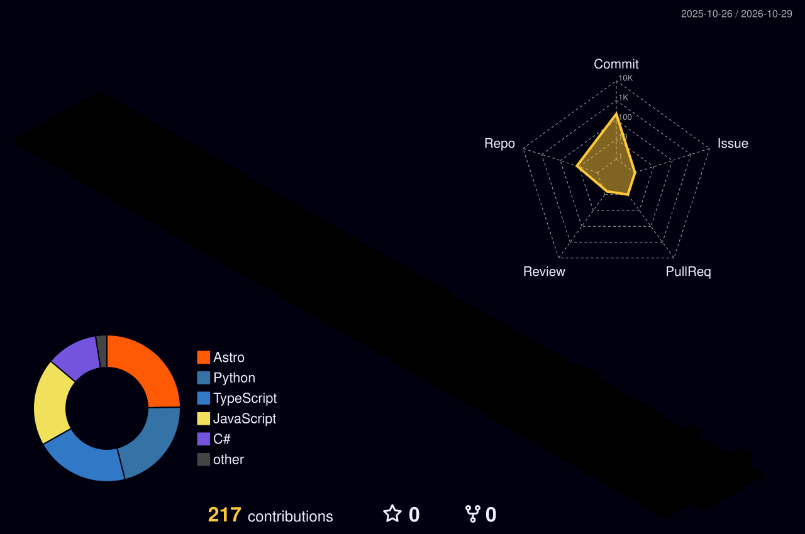

  
  
  

---

## 👋 About

I'm a Full Stack Software Engineer from Konya, Türkiye, and I build software that ships: **three production websites are live**, and I build AI systems from local voice assistants to agents that run a business's Instagram end to end.

- 🤖 **AI & automation**: LLM agents with the Claude API, RAG, local open-source models
- 🌐 **Web**: Next.js, React, Astro, Three.js, Supabase, with SEO and security built in
- 📱 **Mobile & games**: React Native / Expo, Unity multiplayer
- 🎓 B.Sc. in Software Engineering, Istanbul Aydın University (2026)

---

## 🚀 Featured Projects

<table>
<tr>
<td width="50%" valign="top">

### [🤖 Social Autopilot](https://github.com/OmerP14/social-autopilot)

An **Instagram autopilot for small businesses**. Claude researches and plans the content, the system renders posts, carousels and Reels from the business's own photos, the owner approves on Telegram, and approved posts go live automatically.

`Python` `Claude API` `Playwright` `ffmpeg` `Telegram` · **98 tests**

</td>
<td width="50%" valign="top">

### [💪 Profit EMS](https://www.profitems.com)

**Live production website** for an EMS studio in Konya. A rigged **3D Three.js mannequin** explains how EMS works, a browser-only assistant answers questions, and a hash-based CSP keeps it locked down.

`Astro` `Three.js` `Motion` `Vercel` · [Live site](https://www.profitems.com) · [Code](https://github.com/OmerP14/profitems)

</td>
</tr>
<tr>
<td width="50%" valign="top">

### [🎙️ Nova – Voice AI Agent](https://github.com/OmerP14/voice-agent)

A bilingual (TR/EN) voice assistant that runs **fully locally**: Whisper → RAG → Qwen2.5 → Piper. Scored **27/27** on hallucination tests and **38/38** on multi-turn scenarios.

`Python` `FastAPI` `Whisper` `RAG` `Docker`

</td>
<td width="50%" valign="top">

### [🎓 Special Education Management System](https://github.com/OmerP14/special-education-management-system)

A SaaS platform for special education centers: students & guardians, teachers, session scheduling with conflict detection, teacher payroll, installment payments, financial reports, Excel import and role-based access.

`Next.js` `React` `TypeScript` `Supabase`

### 🌐 More live sites
[Konyap](https://konyapmuhendislik.com) · [Ober Yapı](https://oberyapi.com) · [Portfolio](https://omerpehriz.com)

</td>
</tr>
</table>

---

## 🛠️ Tech Stack

 
 

---

## 🧊 Contributions in 3D

  

---

*"Build software that people genuinely enjoy using."*

